<div align="center">

  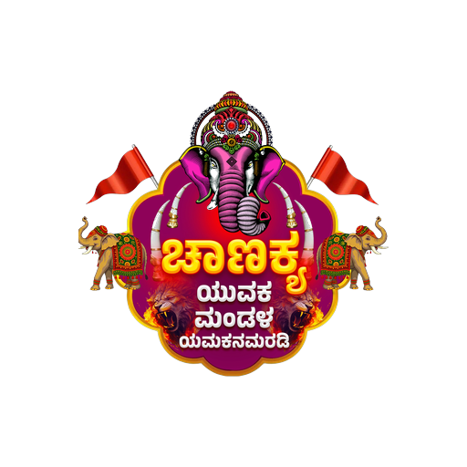

  # ಶ್ರೀ ಚಾಣಕ್ಯ ಯುವಕ ಮಂಡಳ — ೨೦೧೯
  ## Chanakya Yuvak Mandal (CYM) Heritage Web Portal

  <p align="center">
    <strong>"ನಮ್ಮ ಸಂಪ್ರದಾಯ · ನಮ್ಮ ಏಕತೆ · ನಮ್ಮ ಇತಿಹಾಸ"</strong><br/>
    <em>"Our Tradition · Our Unity · Our History"</em><br/>
    <strong>|| ಶ್ರೀ ಗಣೇಶಾಯ ನಮಃ ||</strong>
  </p>

  <p align="center">
    Official digital archive, cultural heritage showcase, and real-time community management portal for<br/>
    <strong>Chanakya Yuvak Mandal (CYM)</strong>, Kadalagi Khoot, Yamakanmardi, Taluk: Hukkeri, District: Belagavi – 591246, Karnataka, India.
  </p>

  <p align="center">
    <a href="https://chanakya-yuvak-mandal-kadalagi-khoot-yamakanmardi.vercel.app/" target="_blank">
      
    </a>
    
    
    
    
    
    
    
  </p>

  <p align="center">
    🚀 <strong>Live Hosted Platform</strong>: <a href="https://chanakya-yuvak-mandal-kadalagi-khoot-yamakanmardi.vercel.app/">https://chanakya-yuvak-mandal-kadalagi-khoot-yamakanmardi.vercel.app/</a>
  </p>

</div>

---

## 📖 Table of Contents

- [🌟 Overview](#-overview)
- [🌐 Live Deployment](#-live-deployment)
- [📸 Visual Showcase & Screen Previews](#-visual-showcase--screen-previews)
  - [1. Sacred Home & Hero Darshan](#1-sacred-home--hero-darshan)
  - [2. Retro 35mm Cinema Filmstrip Reel](#2-retro-35mm-cinema-filmstrip-reel)
  - [3. Heritage & The 4 Sacred Pillars](#3-heritage--the-4-sacred-pillars)
  - [4. Festival Milestones Timeline (2019–2026)](#4-festival-milestones-timeline-20192026)
  - [5. Divya Darshan Multi-Category Gallery](#5-divya-darshan-multi-category-gallery)
  - [6. Executive Committee & Youth Leadership](#6-executive-committee--youth-leadership)
  - [7. Community Seva & Maha Annasantarpane](#7-community-seva--maha-annasantarpane)
  - [8. Contact, Headquarters & Satellite Map](#8-contact-headquarters--satellite-map)
  - [9. Secure Admin Portal & Control Dashboard](#9-secure-admin-portal--control-dashboard)
- [🛠 Tech Stack & Engineering Highlights](#-tech-stack--engineering-highlights)
- [📂 Repository Structure](#-repository-structure)
- [🚀 Quick Start & Installation](#-quick-start--installation)
  - [Prerequisites](#prerequisites)
  - [Clone & Install](#clone--install)
  - [Environment Setup](#environment-setup)
  - [Run Development Server](#run-development-server)
  - [Build for Production](#build-for-production)
- [🌐 Bilingual Localization (i18n)](#-bilingual-localization-i18n)
- [🙏 Community & Heritage Credits](#-community--heritage-credits)
- [📄 License](#-license)

---

## 🌟 Overview

Established in **2019**, **Chanakya Yuvak Mandal (CYM)** is a respected socio-cultural and youth union located at **Kadalagi Khoot, Yamakanmardi** (Belagavi District, Karnataka). 

This portal is a **modern digital archive** that preserves and celebrates 8+ years of sacred Ganesh Mahotsava festivities, while serving as a real-time communication and administrative platform for volunteers, village elders, and devotees worldwide.

### ✨ Highlights at a Glance
* 🪔 **Live YouTube Broadcast Ticker**: Instant real-time alerts when temple darshan is streaming live.
* 🎞️ **Retro 35mm Cinema Reel**: Continuous scrolling filmstrip featuring vintage sprocket borders, frame counters, and smooth video playback.
* 🏛️ **Chronological Festival Archives**: Unbroken milestone documentation from founding year 2019 through 2026+.
* 📸 **Divya Darshan High-Definition Gallery**: Responsive masonry grid with category filters (*Darshan*, *Aagamana*, *Aarti*, *Pandal*, *Visarjan*, *Seva*).
* 🍲 **Community Seva & Maha Annasantarpane**: Philanthropic records recognizing feast sponsors and social welfare drives.
* 🔒 **Secure Admin Control Center**: In-browser video compression engine (<100MB), chunked resilient uploads, and real-time Firestore sync.
* 🌐 **Full Bilingual Parity**: Instant zero-reload toggle between **ಕನ್ನಡ (Kannada)** and **English**.

---

## 🌐 Live Deployment

| Property | Details |
| :--- | :--- |
| **Official Public URL** | **[CYM Web Platform](https://chanakya-yuvak-mandal-kadalagi-khoot-yamakanmardi.vercel.app/)** |
| **Hosting Platform** | [Vercel](https://vercel.com/) (Fluid Edge CDN with Global HTTPS) |
| **Media Delivery** | [Cloudinary Media CDN](https://cloudinary.com/) (Optimized WebP/MP4) |
| **Realtime Database** | [Google Firebase Firestore](https://firebase.google.com/) |

---

## 📸 Visual Showcase & Screen Previews

All screenshots are stored in the dedicated [`screenshots/`](./screenshots) directory.

### 1. Sacred Home & Hero Darshan
*Full-width ambient visual darshan with live coordinates, temple flute synthesizer, golden badges, and smooth audio toggles.*

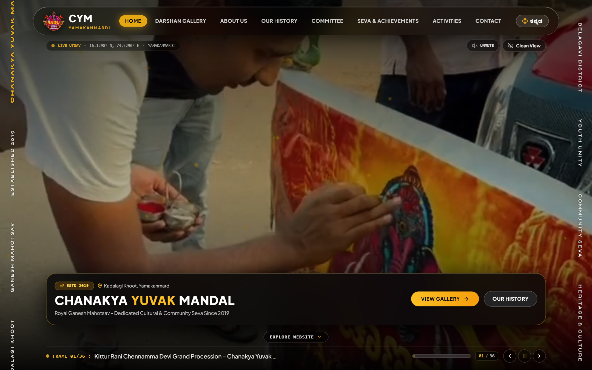

---

### 2. Retro 35mm Cinema Filmstrip Reel
*Vintage analog aesthetic showcasing historic festival moments with authentic film sprocket holes, frame counters, and direct playback controls.*

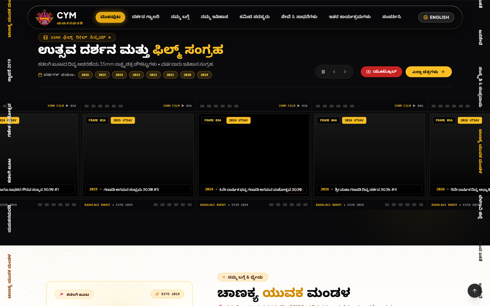

---

### 3. Heritage & The 4 Sacred Pillars
*Chronicle of the union's founding in 2019, built on Bhakti (ಭಕ್ತಿ), Ekata (ಏಕತೆ), Seva (ಸೇವೆ), and Samskruti (ಸಂಸ್ಕೃತಿ).*

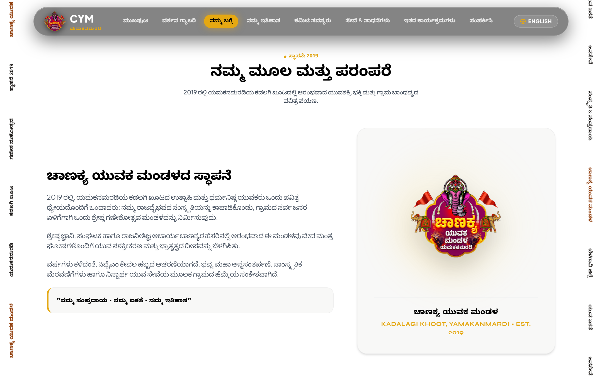

---

### 4. Festival Milestones Timeline (2019–2026)
*Chronological archive tracking annual pandal architecture themes, sculptors (shilpi), samvatsara calendar details, and offerings.*

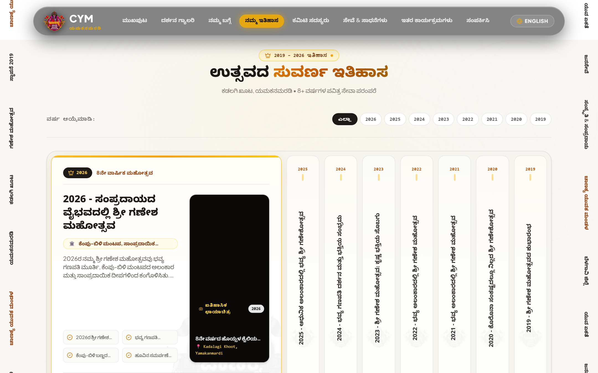

---

### 5. Divya Darshan Multi-Category Gallery
*High-resolution responsive photo grid with category filters, annual milestone selectors, and split-screen lightbox viewer.*

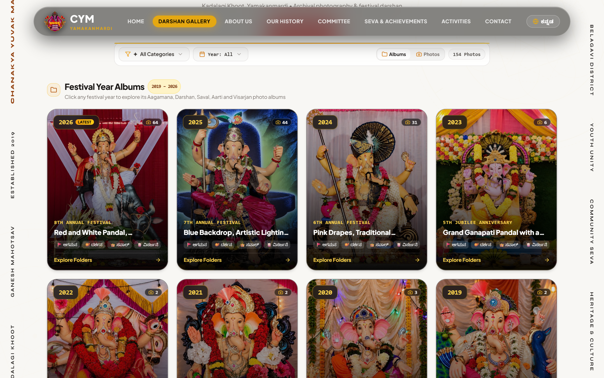

---

### 6. Executive Committee & Youth Leadership
*Directory of founding members, office bearers, core committee members, and youth volunteers with service tenures and designations.*

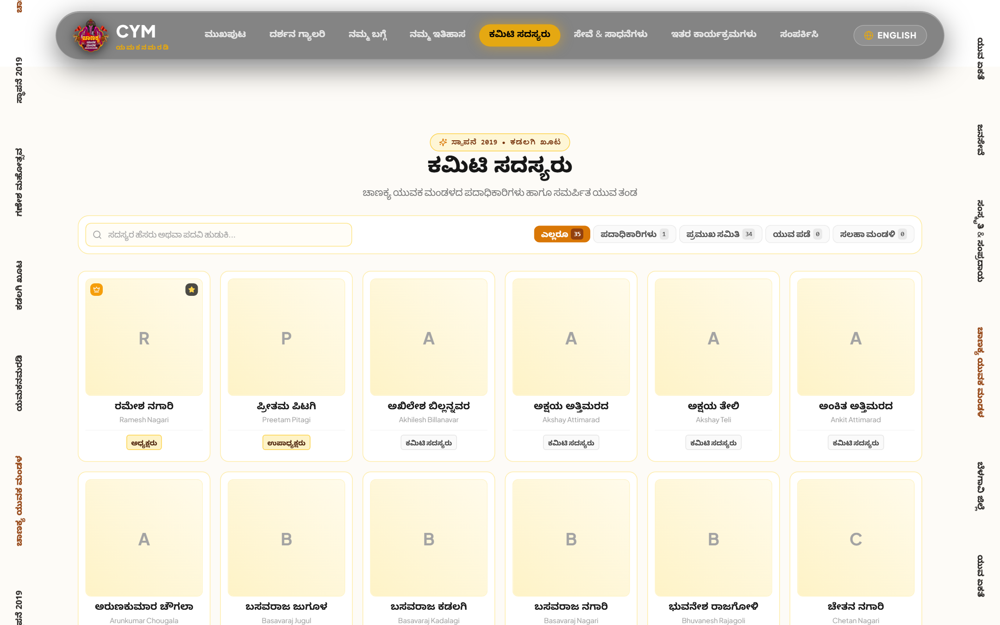

---

### 7. Community Seva & Maha Annasantarpane
*Dedicated record of welfare initiatives, blood donation drives, Annasantarpane feasts, video play controls, and donor acknowledgments.*

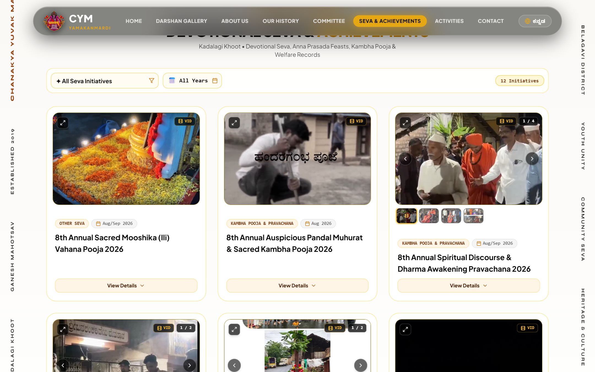

---

### 8. Contact, Headquarters & Satellite Map
*Direct committee contacts, official Mandal email, Instagram, YouTube channel, and interactive satellite/roadmap Google Maps directions to Kadalagi Khoot.*

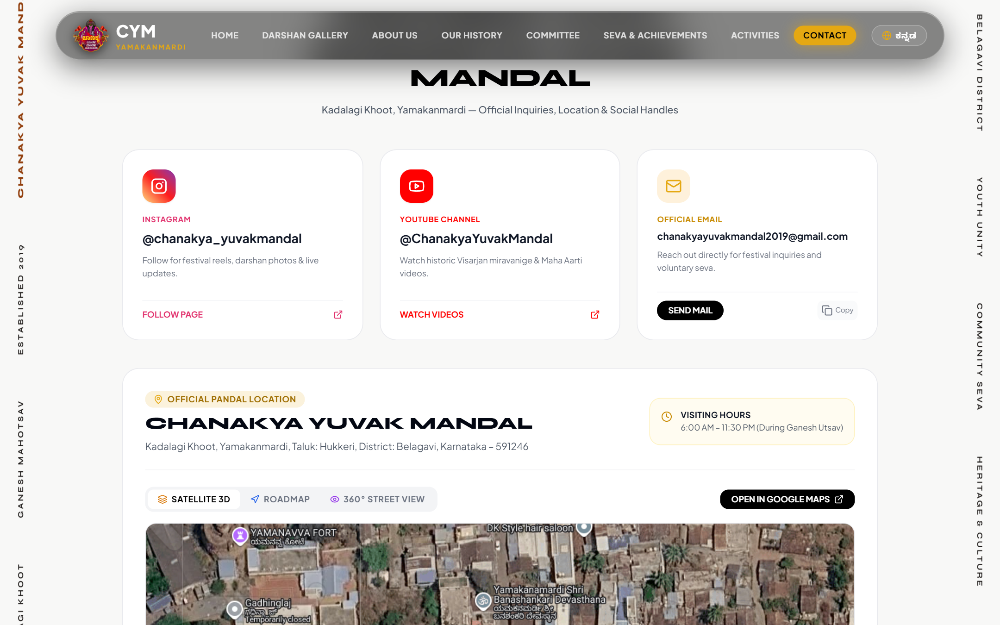

---

### 9. Secure Admin Portal & Control Dashboard
*Protected administrative command center featuring multi-media batch uploading, client-side video downscaling, hero priority ranking, and YouTube Live Stream management. All administrative captures are archived in [`admin_screenshots/`](./admin_screenshots) and [`screenshots/admin/`](./screenshots/admin).*

#### 🔐 Admin Security & Role-Based Entry Gate
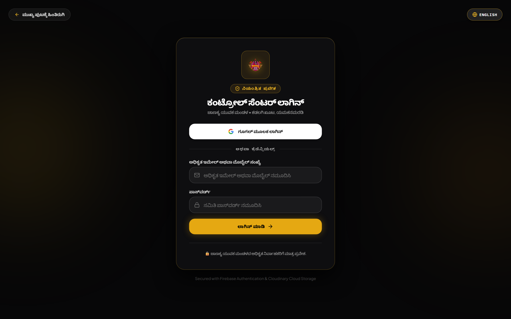

#### 🎛️ Real-Time Admin Command Dashboard
*Live administrative control over 150+ Cloudinary media items, 23 hero loops, 131 film reel frames, and 150 photo gallery archives.*

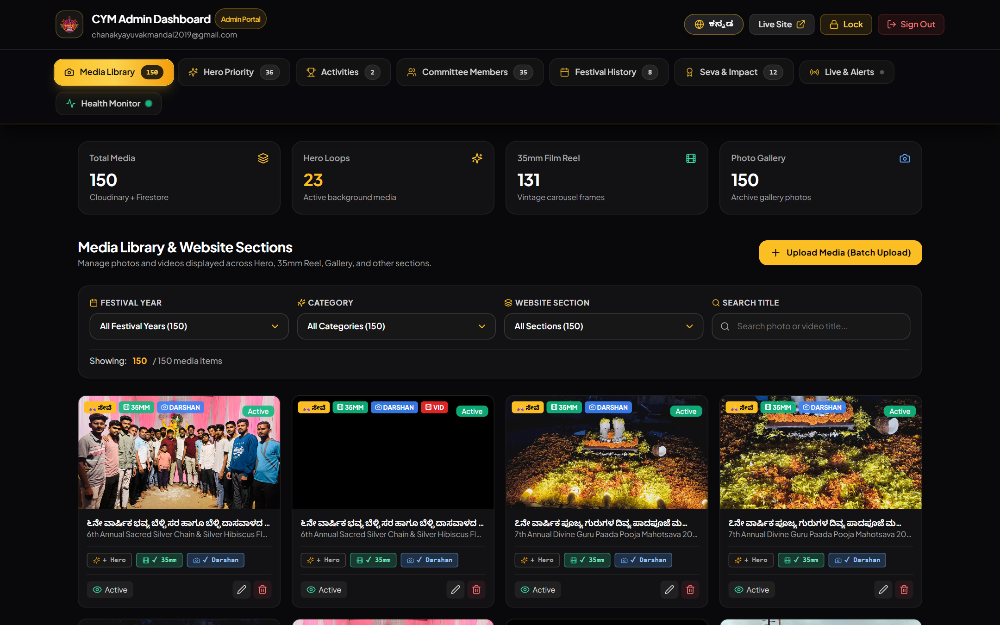

---

## 🛠 Tech Stack & Engineering Highlights

| Layer | Technologies & Tools |
| :--- | :--- |
| **Frontend Framework** | **React 18.3** + **TypeScript 5.5** |
| **Build Tool & Bundler** | **Vite 6.0** with Lightning-Fast Hot Module Replacement (HMR) |
| **Styling & Theme** | **Tailwind CSS 3.4** + Custom Temple Gold Gradients & Apple Glassmorphism |
| **Routing** | **React Router DOM v6** with Clean URLs & SPA Rewrites |
| **Icons & Visuals** | **Lucide React** (Crisp, zero-runtime SVG icons) |
| **Database & Auth** | **Google Firebase Firestore** & Firebase Authentication |
| **Cloud Media Engine** | **Cloudinary CDN** (Unsigned Uploads with auto WebP compression) |
| **Client-Side Compression** | Custom in-browser `<canvas>` + `MediaRecorder` engine shrinking 4K videos under 100MB |
| **Chunked Uploader** | Sequential 15MB byte-slice uploader with 3x exponential backoff retry |
| **Synthesizer** | Native **Web Audio API** generative ambient drone/flute synthesizer |

---

## 📂 Repository Structure

```
├── admin_screenshots/               # Dedicated admin command dashboard showcase
│   ├── admin_dashboard.png          # Real-time media & website control center
│   ├── admin_login.png              # Security authentication gate
│   └── README.md                    # Admin panel overview & features
├── screenshots/                     # High-resolution screenshots of live platform
│   ├── admin/                       # Admin portal visual assets
│   ├── 01_home_hero.png
│   ├── 02_35mm_reel.png
│   ├── 03_about_heritage.png
│   ├── 04_history_timeline.png
│   ├── 05_darshan_gallery.png
│   ├── 06_committee_leadership.png
│   ├── 07_seva_achievements.png
│   ├── 08_contact_location.png
│   ├── 09_admin_portal.png
│   └── 10_admin_dashboard.png
├── public/                          # Static assets served at root
│   ├── assets/
│   │   ├── logo_transparent.png     # Official CYM transparent emblem
│   │   ├── logo_tight.png           # High-resolution brand emblem
│   │   ├── images/                  # Watermarks and fallback posters
│   │   └── videos/                  # Optimized loop previews
│   ├── favicon.ico                  # Browser favicon
│   ├── manifest.json                # PWA web manifest
│   └── robots.txt                   # Search crawler directives
├── src/
│   ├── components/
│   │   ├── admin/                   # Admin Pin Lock, Crop modal, Health monitor
│   │   ├── common/                  # Audio player, animated side rails, loaders
│   │   ├── gallery/                 # Grid filters, Lightbox modal
│   │   ├── history/                 # Timeline cards and navigation rails
│   │   ├── home/                    # Hero slider, 35mm Reel, Stats, Map
│   │   └── layout/                  # Glass capsule Navbar, Footer, Royal divider
│   ├── context/                     # AuthContext with dynamic env credentials
│   ├── data/                        # Static fallback data (site, history, committee)
│   ├── i18n/                        # Kannada (kn.ts) & English (en.ts) dictionaries
│   ├── lib/                         # Firebase SDK config & Cloudinary uploader
│   ├── pages/                       # Home, About, History, Gallery, Seva, Contact, Admin
│   ├── services/                    # Firestore real-time subscriptions & CRUD APIs
│   ├── types/                       # TypeScript interfaces for media, committee, seva
│   ├── utils/                       # Video compressor, YouTube parser, image optimizer
│   ├── App.tsx                      # Root router and global layout
│   ├── main.tsx                     # React DOM entrypoint
│   └── vite-env.d.ts                # Vite environment variable types
├── .env.example                     # Environment variables template
├── .gitignore                       # Clean Git exclusion rules
├── firebase.json                    # Firebase hosting & security configuration
├── firestore.rules                  # Production security rules
├── package.json                     # Dependencies and npm scripts
├── storage.rules                    # Firebase storage rules
├── tailwind.config.js               # Sacred color palettes and animations
├── tsconfig.json                    # Strict TypeScript compiler options
├── vercel.json                      # Vercel SPA routing rewrites
├── vite.config.ts                   # Vite configuration
└── README.md                        # Documentation and project manual
```

---

## 🚀 Quick Start & Installation

### Prerequisites
* **Node.js**: v18.0.0 or higher
* **npm**: v9.0.0 or higher

### Clone & Install
```bash
# Clone the public repository
git clone https://github.com/vishal-kadalagi/Chanakya-Yuvak-Mandal-CYM--Heritage-Web.git

# Navigate into the project directory
cd Chanakya-Yuvak-Mandal-CYM--Heritage-Web

# Install dependencies
npm install
```

### Environment Setup
Create a `.env` file by copying the provided example template:
```bash
cp .env.example .env
```

Configure your credentials inside `.env`:
```env
# Firebase Configuration
VITE_FIREBASE_API_KEY=your_firebase_api_key
VITE_FIREBASE_AUTH_DOMAIN=your_project.firebaseapp.com
VITE_FIREBASE_PROJECT_ID=your_project_id
VITE_FIREBASE_STORAGE_BUCKET=your_project.firebasestorage.app
VITE_FIREBASE_MESSAGING_SENDER_ID=your_sender_id
VITE_FIREBASE_APP_ID=your_app_id
VITE_FIREBASE_MEASUREMENT_ID=your_measurement_id

# Cloudinary Media Configuration
VITE_CLOUDINARY_CLOUD_NAME=your_cloud_name
VITE_CLOUDINARY_UPLOAD_PRESET=your_unsigned_preset

# Admin Portal Credentials
VITE_ADMIN_EMAIL=admin@example.com
VITE_ADMIN_PHONE=9999999999
VITE_ADMIN_PASSWORD=YourSecurePassword
VITE_ADMIN_PIN=1234
```

### Run Development Server
```bash
npm run dev
```
Open your browser at **`http://localhost:5173`** to explore the local development environment with instant hot module replacement.

### Build for Production
To test TypeScript definitions and compile the production bundle:
```bash
npm run build
```
To test and preview the production build locally:
```bash
npm run preview
```

---

## 🌐 Bilingual Localization (i18n)

The portal features comprehensive dual-language support:
* **ಕನ್ನಡ (Kannada)**: Native language for local devotees and village elders.
* **English**: Global interface for youth, distant community members, and guests.

Language preferences are automatically preserved in browser `localStorage` (`cym_language`). Translations are neatly centralized in:
* `src/i18n/kn.ts` — Complete Kannada strings.
* `src/i18n/en.ts` — Complete English strings.
* `src/i18n/LanguageContext.tsx` — Lightweight context provider with zero reloads.

---

## 🙏 Community & Heritage Credits

* **Organization**: Chanakya Yuvak Mandal (CYM)
* **Established**: 2019
* **Headquarters**: Kadalagi Khoot, Yamakanmardi, Taluk: Hukkeri, District: Belagavi – 591246, Karnataka, India
* **Dedication**: In sacred service of **Lord Vighnaharta Maha Ganapati**, honoring the selfless youth volunteers, village elders, festival donors, and devotees of Yamakanmardi.

---

## 📄 License

This project is licensed under the [MIT License](LICENSE).

---

<div align="center">
  <strong>|| ಗಣಪತಿ ಬಪ್ಪಾ ಮೋರಯಾ · ಮಂಗಳ ಮೂರ್ತಿ ಮೋರಯಾ ||</strong><br/>
  <em>|| Ganapati Bappa Morya · Mangala Murti Morya ||</em>
</div>
