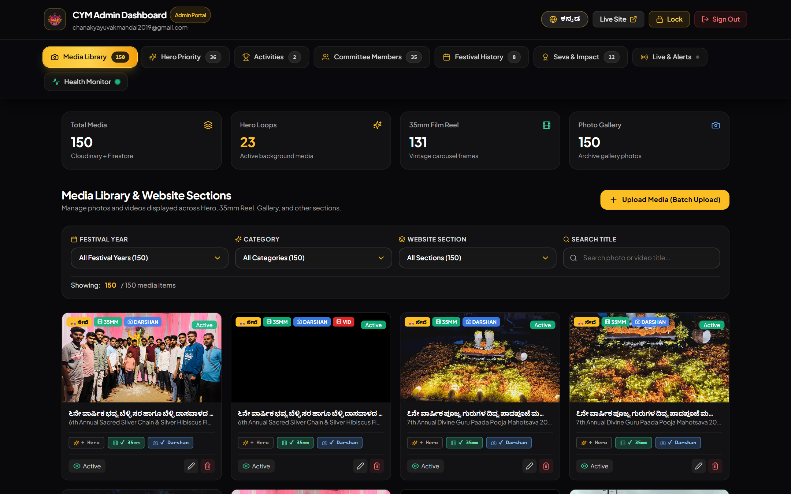
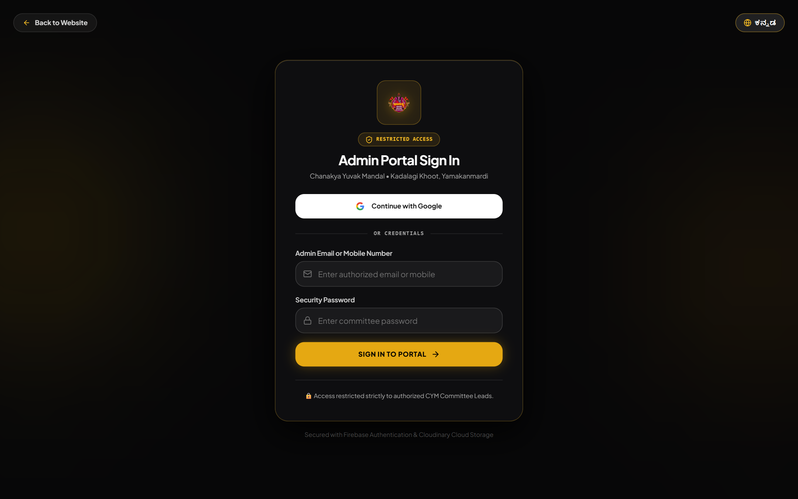

# ⚙️ Chanakya Yuvak Mandal (CYM) — Admin Control Center

This directory contains visual captures of the secure, real-time administrative interface powering the **Chanakya Yuvak Mandal Heritage Web Portal**.

---

## 📸 Admin Previews

### 1. Real-Time Admin Command Dashboard
*Live management of 150+ Cloudinary media assets, hero background loops, 35mm celluloid frames, photo gallery filters, and batch uploads.*

### 2. Admin Authentication & Security Gate
*Role-based secure entry with Google Firebase Authentication and PIN lock safeguard.*

---

## 🛠️ Key Admin Capabilities

* 📂 **Media Library (150+ items)**: Real-time Cloudinary and Firestore synchronized media repository.
* 🌟 **Hero Loop Prioritizer (23 active)**: Drag-and-drop or rank background video and photo sequences.
* 🎞️ **35mm Reel Manager (131 frames)**: Vintage filmstrip curator with frame counter tags and year bindings.
* 🖼️ **Photo Gallery Manager (150 archives)**: High-resolution festival photo catalog with category tagging (*Darshan*, *Aagamana*, *Aarti*, *Visarjan*, *Seva*).
* ⚡ **Batch Uploader**: Multi-file drag & drop supporting in-browser client-side video downscaling (<100MB).
* 👥 **Committee Directory Editor**: Real-time management of members, roles, designations, and tenures.
* 📜 **Festival Milestones**: Annual pandal themes, sculptors (shilpi), samvatsara calendars, and historical summaries.
* 🚨 **System Health Monitor**: Live Firebase and Cloudinary API status and connection checks.
